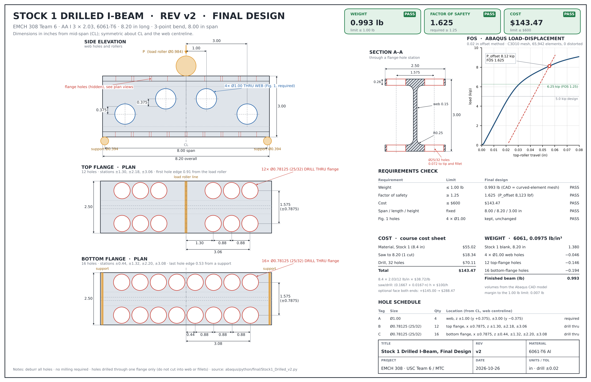

# Final Design: Stock 1 Drilled v2 (Rev B)

Everything for the final beam in one place. These are **copies**: each file also stays in its original location in the repo (listed below). If you change a file, change the original and refresh the copy here, so the two stay identical.

## Summary

- **Stock:** Stock 1, AA I 3 × 2.03 aluminum (6061), saw-cut to 8.20 in
- **Holes:** 4 × Ø1.00 in web holes (required) + 28 × Ø25/32 in flange holes, drill thru
- **Drawing revision:** Rev B (Rev A was the earlier Stock 3 package sent to Midlands Technical College (MTC))

| Requirement | Limit | Final design | |
|---|---|---|---|
| Weight | ≤ 1.00 lb | 0.993 lb | Pass |
| Factor of safety (FoS), 0.02 in offset method | ≥ 1.25 | 1.625 (offset load 8,123 lbf) | Pass |
| Cost (course cost sheet) | ≤ $600 | $143.47 | Pass |

## What's here

| Folder | File | What it is | Original location |
|---|---|---|---|
| `Abaqus/` | `Stock1_Drilled_v2.cae` / `.jnl` | Final Abaqus model | `abaqus/final_design/` |
| `Abaqus/job/` | `Stock1_Drilled_v2.cae` / `.jnl` | Model with the analysis job defined | `abaqus/final_design/job/` |
| | `Stock1_Drilled_v2.inp` | Abaqus input file for the job | `abaqus/final_design/job/` |
| | `Stock1_Drilled_v2.odb` | Results (314 MB, Git LFS) | `abaqus/final_design/job/` |
| `Results/` | `FOS_Stock1_Drilled_v2.txt` | FoS, weight, cost and first-yield report | `results/final_design/` |
| | `FOS_Stock1_Drilled_v2_LoadDisp.csv` | Load–displacement data with offset line | `results/final_design/` |
| | `Stock1_Drilled_v2_LoadDisp.png` | Load–displacement plot | `results/final_design/` |
| | `Design_Comparison.png` | All design iterations compared | `results/` |
| `Drawings/` | `USC06_MTC06_IBeam_RevB_Drawing.pdf` + `_sheet1/2.png` | Manufacturing drawing for MTC (2 sheets) | `cad/` |
| | `USC06_MTC06_IBeam_RevB_Drawing_GDT_version.pdf` / `.png` | Same drawing with geometric dimensioning and tolerancing (GD&T) | `cad/drawings/` |
| | `Design_Sheet_Stock1_Drilled_v2.pdf` / `.png` | One-page design sheet: views, dimensions, cost, FoS, weight | `cad/drawings/` |
| | `Hole_Layout_Stock1_Drilled_v2.png` | Hole positions | `cad/drawings/` |
| `CAD/` | `USC06_MTC06_IBeam_RevB.step` | 3D model for MTC (inches) | `cad/` |
| | `usc06_mtc06_ibeam_revb_.prt.3` | Creo Parametric part | `cad/creo/` |
| `Cost/` | `ProjectCostSheet_Stock1_Drilled_v2.xlsx` | Course cost sheet, filled in | `cost/` |
| `Scripts/` | `Stock1_Drilled_v2.py` | Builds the final model and submits the job | `abaqus/python/final/` |
| | `FOS_Stock1_Drilled_v3.py` | Reads the `.odb`; reports FoS, weight, cost, first yield | `abaqus/python/final/` |
| | `Export_STEP_v3.py` | Exports the STEP file | `abaqus/python/final/` |
| | `make_RevB_drawing_v3.py` | Generates the Rev B manufacturing drawing | `cad/drawings/source/` |

## Opening the results

The `.odb` is stored with Git Large File Storage (LFS). Run `git lfs install` once before cloning (or `git lfs pull` in an existing clone) to get the real 314 MB file instead of a small pointer. Then open `Abaqus/job/Stock1_Drilled_v2.odb` in Abaqus/CAE (**File → Open**, file type *Output Database*).

To regenerate the FoS report, set the Abaqus work directory to any folder in the repo and **Run Script** → `FOS_Stock1_Drilled_v3.py`. It writes to `results/final_design/` (the original location); copy the new files here afterwards.

The FoS report header shows the `.odb` path from the computer it was first run on (`E:\Semester Project\...`). That path is just a record; the numbers come from the same `.odb` that is in this folder.
