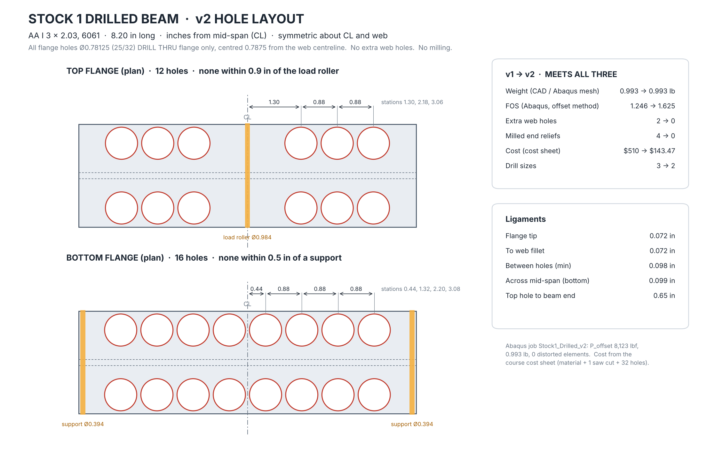
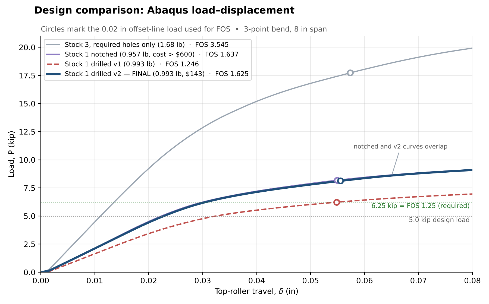

# EMCH 308 Semester Project: Lightweight I-Beam Design

Finite element design and validation of an 8" × 3" I-beam for EMCH 308 (Introduction to Finite Element Stress Analysis) at the University of South Carolina (USC), Fall 2026. The beam was designed by a USC team and manufactured in partnership with Midlands Technical College (MTC).

## Team 6

| Name | Institution | Contact |
|---|---|---|
| Chase Gregg | USC | cgregg@email.sc.edu |
| Sam McKool | USC | smckool@email.sc.edu |
| James Dierdorf | USC | dierdorf@email.sc.edu |
| Ryan Bilock | USC | rbilock@email.sc.edu |
| David Wilson | MTC | davidwilson358@student.midlandstech.edu |

**Instructors:** 
| Name | Institution | Contact |
|---|---|---|
| Andrew Gross | USC | andrewgross@sc.edu |
| Gary Shannon | MTC | shannong@midlandstech.edu |

## Design requirements

- **Weight:** ≤ 1 lbf
- **Strength:** factor of safety (FoS) ≥ 1.25 for a 5,000 lbf load in 3-point bending
- **Cost:** total manufacturing cost ≤ $600, using one of three approved stock options
- **Fixed geometry:** 8" span, 3" height, four Ø1" through holes (additional material removal allowed)

## Test setup

- Central steel load roller, Ø0.984"
- Two steel support rollers, Ø0.394", 8" center-to-center
- Loaded to 6,250 lbf; FoS checked against a 0.02" offset line from the linear-elastic load–displacement response

## Final design: Stock 1 drilled v2

- **Stock:** Stock 1, AA I 3 × 2.03 (6061), cut to 8.20 in
- **Holes:** 4 × Ø1.00 Fig. 1 web holes (required) + 28 × Ø25/32 (0.78125) flange holes, drill thru, centred ±0.7875 from the web
  - Top flange: z = ±1.30, ±2.18, ±3.06 in from mid-span (12 holes)
  - Bottom flange: z = ±0.44, ±1.32, ±2.20, ±3.08 in from mid-span (16 holes)
- **Drawing:** [`cad/drawings/Hole_Layout_Stock1_Drilled_v2.png`](cad/drawings/Hole_Layout_Stock1_Drilled_v2.png)
- **No milling, no extra web holes.** Holes are kept clear of the load roller and the supports, where the web yields first.



| Requirement | Limit | Final design | |
|---|---|---|---|
| Weight | ≤ 1.00 lb | 0.993 lb (CAD and curved-element mesh agree) | Pass |
| FoS (offset method, 0.02 in) | ≥ 1.25 | 1.625 (P_offset = 8,123 lbf) | Pass |
| Cost (course cost sheet) | ≤ $600 | $143.47 | Pass |

**Cost breakdown** (course cost-sheet formulas; filled-in sheet: [`cost/ProjectCostSheet_Stock1_Drilled_v2.xlsx`](cost/ProjectCostSheet_Stock1_Drilled_v2.xlsx)):

| Item | Calculation | Cost |
|---|---|---|
| Material, Stock 1 | 8.4 in × 2.03/12 lb/in × $38.72/lb | $55.02 |
| Saw cut to 8.20 in (1 cut) | (0.1667 + 0.0167 × 1) h × $100/h | $18.34 |
| Drill (4 Fig. 1 + 28 flange = 32 holes) | (0.1667 + 0.0167 × 32) h × $100/h | $70.11 |
| **Total** | | **$143.47** |

If MTC needs the ends faced for length tolerance (saw ±0.02 in vs. face ±0.005 in), add facing both ends: (0.5 + 0.04 × 2) h × $250/h = $145.00, for a total of $288.47 — still under $600.

## Repository layout

```
├── abaqus/
│   ├── base_models/            ProjectBeam.cae (original model: rollers, material) · Baseline_Stock1.cae
│   ├── final_design/           Stock1_Drilled_v2.cae / .jnl  (final model)
│   │   └── job/                Stock1_Drilled_v2 job: .cae with job, .jnl, .inp
│   ├── iterations/
│   │   ├── Stock1_Notched/     .cae, .jnl, .inp
│   │   └── Stock1_Drilled_v1/  model .cae / .jnl  +  job/ (.cae, .jnl, .inp)
│   └── python/
│       ├── final/              Stock1_Drilled_v2.py (builds final model + job) · FOS_Stock1_Drilled_v2.py
│       ├── tools/              Baseline_Stock1_v1.py · FOS_ProjectBeam_v3.py (FoS for any .odb)
│       ├── iterations/         Scripts for the notched, plain and drilled v1 designs
│       └── fix_history/        Repair scripts for the original model, v1–v5 (see its README)
├── results/
│   ├── Design_Comparison.png   All four Abaqus load–displacement curves
│   ├── final_design/           Stock 1 drilled v2: FoS report, CSV, plot
│   └── iterations/             Stock3_Beam_8p2in · Stock1_Notched · Stock1_Drilled_v1
├── cad/
│   ├── drawings/               Hole_Layout_Stock1_Drilled_v2.png (final hole layout)
│   └── concept_drawings/       Earlier material-removal and cost-plan concepts (superseded)
├── cost/                       Course cost sheet filled in for the final design
├── report/                     Final report (to come)
└── Blackboard Files/           Course documents: project statement, rubric, guide, blank cost sheet
```

**Not on GitHub:** the `.odb` result files (300+ MB each) are over GitHub's 100 MB file limit. They stay on the team's project drive and can be regenerated from the `.inp` in each job folder.

## Running the models

1. In Abaqus/CAE, **File → Set Work Directory** → `abaqus/base_models/` (the folder holding `ProjectBeam.cae`).
2. **File → Run Script** → `abaqus/python/final/Stock1_Drilled_v2.py`. It builds the final beam, saves `Stock1_Drilled_v2.cae`, and submits the job in a `Stock1_Drilled_v2/` folder next to it (about 30 min).
3. When the job shows *Completed*, **Run Script** → `abaqus/python/final/FOS_Stock1_Drilled_v2.py`. It finds the `.odb`, reports weight, FoS, cost and where the beam yields first, and saves a report, CSV and plot.

Scripts write their output next to `ProjectBeam.cae`; move the finished model and job into `abaqus/final_design/` to match this layout.

## Design history



| Design | Weight (lb) | FoS | Cost | Status |
|---|---|---|---|---|
| Stock 3, required holes only | 1.68 | 3.545 | — | Too heavy |
| Stock 1, notched flanges | 0.957 | 1.637 | over $600 (milling) | Meets weight and FoS, cost too high |
| Stock 1, drilled v1 (32 flange + 2 web holes, milled end reliefs) | 0.993 | 1.246 | $510 | Fails FoS: the web yields around the extra web holes |
| **Stock 1, drilled v2 (28 × Ø25/32 flange holes)** | **0.993** | **1.625** | **$143.47** | **Final: meets all three** |

## Tools

- Abaqus/CAE (finite element modeling and analysis)
- Python (scripting and post-processing)
