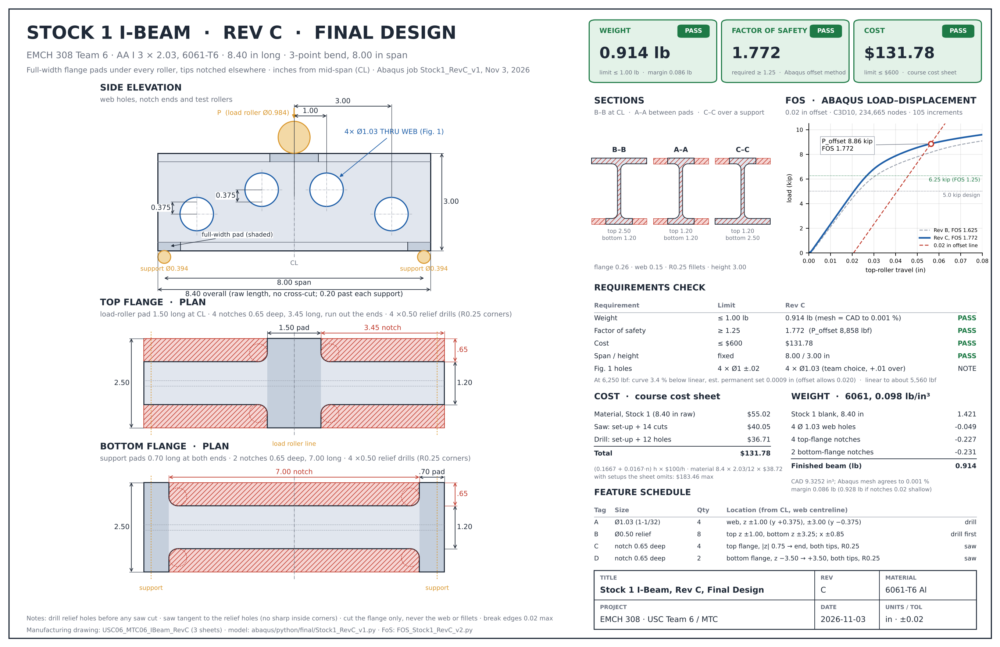
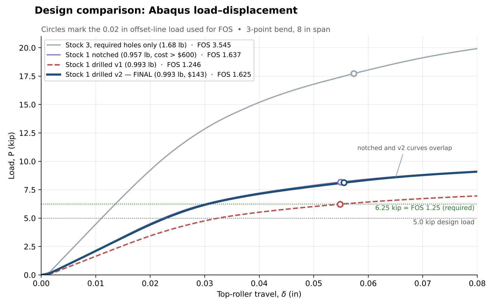

# EMCH 308 Semester Project: Lightweight I-Beam Design

Finite element design and validation of an 8" × 3" I-beam for EMCH 308 (Introduction to Finite Element Stress Analysis) at the University of South Carolina (USC), Fall 2026. The beam was designed by a USC team and manufactured in partnership with Midlands Technical College (MTC).

## Team 6

| Name | Institution | Contact |
|---|---|---|
| Chase Gregg | USC | cgregg@email.sc.edu |
| Sam McKool | USC | smckool@email.sc.edu |
| James Dierdorf | USC | dierdorf@email.sc.edu |
| Ryan Bilock | USC | rbilock@email.sc.edu |
| David Wilson | MTC | davidwilson358@student.midlandstech.edu |

**Instructors:** 
| Name | Institution | Contact |
|---|---|---|
| Andrew Gross | USC | andrewgross@sc.edu |
| Gary Shannon | MTC | shannong@midlandstech.edu |

## Design requirements

- **Weight:** ≤ 1 lbf
- **Strength:** factor of safety (FoS) ≥ 1.25 for a 5,000 lbf load in 3-point bending
- **Cost:** total manufacturing cost ≤ $600, using one of three approved stock options
- **Fixed geometry:** 8" span, 3" height, four Ø1" through holes (additional material removal allowed)

## Test setup

- Central steel load roller, Ø0.984"
- Two steel support rollers, Ø0.394", 8" center-to-center
- Loaded to 6,250 lbf; FoS checked against a 0.02" offset line from the linear-elastic load–displacement response

## Final design: Rev C (Abaqus run complete)

Rev C replaced Rev B as the team's final design in Nov 2026, to gain weight margin (Rev B was 0.993 lb) and keep the flanges full width under every test roller. The Abaqus run (Nov 3, 2026) confirms it meets all three requirements. Everything for it is in [`Final_Design/`](Final_Design/).

- **Stock:** Stock 1, AA I 3 × 2.03 (6061-T6), full 8.40 in raw length (no cross-cut; 0.20 in overhang past each support vs. 0.10 in on Rev B)
- **Flanges:** full 2.50 in width kept wherever a roller touches: top flange |z| ≤ 0.75 in (load roller), bottom flange |z| ≥ 3.50 in (supports). Elsewhere the tips are notched 0.65 in deep (flange 1.20 in wide).
- **Corners:** 8 × Ø0.50 relief holes drilled first; saw cuts end tangent to them, so every inside corner is R0.25 (no sharp corners)
- **Web:** unchanged except the 4 required holes, opened to Ø1.03 (1-1/32 drill). Note: Fig. 1 allows Ø1.00 ± 0.02.
- **Design sheet (views, dimensions, FoS curve, cost, weight):** [`cad/drawings/Design_Sheet_Stock1_RevC_v1.pdf`](cad/drawings/Design_Sheet_Stock1_RevC_v1.pdf) · [PNG](cad/drawings/Design_Sheet_Stock1_RevC_v1.png)
- **Manufacturing drawing (for MTC, 3 sheets):** [`cad/USC06_MTC06_IBeam_RevC_Drawing.pdf`](cad/USC06_MTC06_IBeam_RevC_Drawing.pdf)
- **STEP file (for MTC, inches):** [`cad/USC06_MTC06_IBeam_RevC.step`](cad/USC06_MTC06_IBeam_RevC.step), checked: one valid solid, 8.40 × 2.50 × 3.00 in, 9.3252 in³
- **Concept sheet:** [`cad/concept_drawings/Proposal_RevC_Stock1_v2.pdf`](cad/concept_drawings/Proposal_RevC_Stock1_v2.pdf) (script: `cad/drawings/source/make_RevC_concept_v2.py`)
- **Cost sheet:** [`cost/ProjectCostSheet_RevC_Stock1_v2.xlsx`](cost/ProjectCostSheet_RevC_Stock1_v2.xlsx)



| Requirement | Limit | Rev C | |
|---|---|---|---|
| Weight (0.098 lb/in³) | ≤ 1.00 lb | 0.914 lb (Abaqus mesh 0.9139 lb, matches CAD to 0.001 %; 0.928 lb if every notch is 0.02 in shallow) | Pass |
| FoS (offset method, 0.02 in) | ≥ 1.25 | **1.772** (P_offset = 8,858 lbf, Abaqus, 234,665-node mesh) | Pass |
| Cost (course cost sheet) | ≤ $600 | $131.78 | Pass |

| Item | Calculation | Cost |
|---|---|---|
| Material, Stock 1 | 8.4 in × 2.03/12 lb/in × $38.72/lb | $55.02 |
| Saw (14 cuts) | (0.1667 + 0.0167 × 14) h × $100/h | $40.05 |
| Drill (4 web + 8 relief = 12 holes) | (0.1667 + 0.0167 × 12) h × $100/h | $36.71 |
| **Total** | | **$131.78** |

With extra setups the sheet does not model (second drill size, flipping between flanges, a cross-cut) the total is $183.46, still under $600. If MTC has to mill the notches instead of sawing them, the cost goes to about $1,860–$3,890 and the design fails the cost limit.

**Open items:** confirm the sawn notches with MTC · optional: warning-free rerun (`fix_Stock1_RevC_v1.py`; the first try was stopped by the license server after 5 clean increments) and mesh-convergence job.

## Previous design: Rev B (Stock 1 drilled v2, superseded)

The last fully analysed design. All its files are in [`Old_Designs/RevB_Stock1_Drilled_v2/`](Old_Designs/RevB_Stock1_Drilled_v2/).

- Stock 1, cut to 8.20 in · 4 × Ø1.00 web holes + 28 × Ø25/32 flange holes, drilled
- Weight 0.993 lb · FoS 1.625 (P_offset = 8,123 lbf) · cost $143.47 — meets all three, but with almost no weight margin
- Design sheet: [`cad/old_designs/RevB/drawings/Design_Sheet_Stock1_Drilled_v2.pdf`](cad/old_designs/RevB/drawings/Design_Sheet_Stock1_Drilled_v2.pdf) · Manufacturing drawing: [`cad/old_designs/RevB/USC06_MTC06_IBeam_RevB_Drawing.pdf`](cad/old_designs/RevB/USC06_MTC06_IBeam_RevB_Drawing.pdf) · Cost sheet: [`cost/old_designs/ProjectCostSheet_Stock1_Drilled_v2.xlsx`](cost/old_designs/ProjectCostSheet_Stock1_Drilled_v2.xlsx)

## Repository layout

**Looking for the final design?** Everything for Rev C is copied into [`Final_Design/`](Final_Design/); Rev B is in [`Old_Designs/RevB_Stock1_Drilled_v2/`](Old_Designs/RevB_Stock1_Drilled_v2/). The originals stay in the folders below.

```
├── Final_Design/               Rev C (current): model, job, results, drawings, STEP, cost sheet, scripts (see its README)
├── Old_Designs/
│   └── RevB_Stock1_Drilled_v2/ Rev B package: model, job, .odb, FoS report, drawings, STEP, cost, scripts
├── abaqus/
│   ├── base_models/            ProjectBeam.cae (original model: rollers, material) · Baseline_Stock1.cae ·
│   │                           ProjectBeam_fixed.cae (original model after the fix_history repairs)
│   ├── iterations/
│   │   ├── Stock1_Drilled_v2_RevB/  Rev B model .cae / .jnl  +  job/ (.cae, .jnl, .inp, .odb via Git LFS)
│   │   ├── Stock3_Beam_8p2in/  Beam_8p2in.inp (Stock 3, 8.2 in Rev A design; source of the Stock 3 results) ·
│   │   │                       Beam_8p2in_v10_refined.inp (finer mesh, fix_ProjectBeam v10; no results)
│   │   ├── Stock1_Plain/       .cae, .jnl, .inp (Stock 1, no material removed)
│   │   ├── Stock1_Notched/     .cae, .jnl, .inp
│   │   └── Stock1_Drilled_v1/  model .cae / .jnl  +  job/ (.cae, .jnl, .inp)
│   ├── final_design/           Rev C model Stock1_RevC_v1.cae · job/ (.cae, .inp, .jnl, geometry; .odb on the
│   │                           project drive only) · job_v2/ and mesh_check/ for the optional reruns
│   └── python/
│       ├── final/              Rev C: Stock1_RevC_v1.py (build + finest mesh + job) · fix_Stock1_RevC_v1.py
│       │                       (warning-free rerun) · FOS_Stock1_RevC_v3.py · Export_STEP_v4.py (STEP)
│       │                       (FoS, weight and accuracy report)
│       ├── iterations/         Scripts for every earlier design, incl. Rev B: Stock1_Drilled_v2.py ·
│       │                       FOS_Stock1_Drilled_v3.py · Export_STEP_v3.py
│       ├── tools/              Baseline_Stock1_v1.py · FOS_ProjectBeam_v3.py (FoS for any .odb)
│       └── fix_history/        Repair scripts for the original model, v1–v5 (see its README)
├── results/
│   ├── Design_Comparison.png   Abaqus load–displacement curves of the earlier designs
│   ├── final_design/           Rev C FoS report, CSV, plot (written by FOS_Stock1_RevC_v1.py)
│   └── iterations/             Stock1_Drilled_v2_RevB · Stock3_Beam_8p2in · Stock1_Notched · Stock1_Drilled_v1
├── cad/
│   ├── USC06_MTC06_IBeam_RevC.step          3D model for MTC (Rev C, inches)
│   ├── USC06_MTC06_IBeam_RevC_Drawing.pdf   Manufacturing drawing for MTC (Rev C, 3 sheets) + _sheet1–3.png
│   ├── concept_drawings/       Proposal_RevC_Stock1_v2 (current design) · earlier material-removal and cost-plan concepts
│   ├── drawings/               Design_Sheet_Stock1_RevC_v1 (one-page design sheet)
│   │   └── source/             Drawing scripts: make_RevC_drawing_v1 · make_RevC_design_sheet_v1 ·
│   │                           make_RevC_concept_v1–v2 · make_RevB_drawing_v1–v3
│   └── old_designs/RevB/       Rev B STEP, manufacturing drawing (2 sheets), creo/ part, drawings/ (design sheet,
│                               hole layout, GD&T version)
├── cost/                       ProjectCostSheet_RevC_Stock1_v2.xlsx (current) · old_designs/ (Rev B)
├── report/                     Final report (to come)
├── Blackboard Files/           Course documents: project statement, rubric, guide, blank cost sheet
├── Organize_Project_v4.py      One-time script that tidied the project drive into the first layout
└── Organize_Project_v5.py      Brings a local copy into this layout (git sync + local-only files); see below
```

**Rev B results (`.odb`):** `abaqus/iterations/Stock1_Drilled_v2_RevB/job/Stock1_Drilled_v2.odb` (314 MB) is stored with [Git Large File Storage (LFS)](https://git-lfs.com), since it is over GitHub's 100 MB file limit. Install Git LFS once (`git lfs install`) before cloning, or run `git lfs pull` in an existing clone, to download the real file instead of a small pointer. Open it in Abaqus/CAE or run `FOS_Stock1_Drilled_v3.py` on it directly — no need to re-run the 30-minute job.

**Not on GitHub:** the iteration `.odb` files (50–540 MB each) and the Rev C `.odb` (519 MB). They stay on the team's project drive and can be regenerated from the `.inp` in each job folder.

## Running the models

**Rev C** (scripts in `abaqus/python/final/`):

1. In Abaqus/CAE, **File → Set Work Directory** → `abaqus/base_models/` (the folder holding `ProjectBeam.cae`).
2. **File → Run Script** → `Stock1_RevC_v1.py`. It builds the Rev C beam, searches for the finest C3D10 mesh under the license's 250,000-node limit (allow 20–45 min of meshing), and submits job `Stock1_RevC_v1`. It saves straight into `abaqus/final_design/` (model) and `abaqus/final_design/job/` (job files, `.odb`, `Stock1_RevC_v1_geometry.txt`). The fine job takes roughly 1–3 hours.
3. *(Optional, for the accuracy report)* set `MESH_LEVEL = 'CHECK'` at the top of `Stock1_RevC_v1.py` and run it again. It builds the same beam at the Rev B mesh density as job `Stock1_RevC_v1_MeshCheck` in `abaqus/final_design/mesh_check/` (about 30–40 min).
4. When the job reads *Completed*, **Run Script** → `FOS_Stock1_RevC_v3.py` (work directory anywhere in the repo). It reports weight, FoS and cost against the limits, the solver warning/error count, and accuracy checks: mesh volume vs. CAD volume vs. hand calculation, FoS sensitivity to the elastic-fit window, curve resolution, mesh convergence (if step 3 was run), where the curve departs from linear, and the permanent set at 6,250 lbf. Output: `results/final_design/`.
5. **Warning-free rerun:** **Run Script** → `fix_Stock1_RevC_v1.py`. The v1 job finished with 7 warnings, all from one rejected attempt while the beam settled onto the supports. This opens `Stock1_RevC_v1.cae` (same mesh), starts the support-roller contacts closed and uses a 0.1 % first increment, and submits job `Stock1_RevC_v2` in `abaqus/final_design/job_v2/` (about 2 hours). `FOS_Stock1_RevC_v3.py` then reports v2 and compares it with v1.
6. **STEP file for MTC:** **Run Script** → `Export_STEP_v4.py`. It checks the Rev C beam (8.40 × 2.50 × 3.00 in, 9.3252 in³, 4 × Ø1.03 holes) and writes `cad/USC06_MTC06_IBeam_RevC.step`, labelled in inches.

`cad/drawings/source/make_RevC_concept_v2.py` (plain Python with numpy and matplotlib) redraws the concept sheet and recomputes its weight, cost and hand-calc stresses.

**Rev B** (kept for reference; scripts in `abaqus/python/iterations/`):

1. In Abaqus/CAE, **File → Set Work Directory** → `abaqus/base_models/` (the folder holding `ProjectBeam.cae`).
2. **File → Run Script** → `Stock1_Drilled_v2.py`. It builds the Rev B beam, saves `Stock1_Drilled_v2.cae`, and submits the job in a `Stock1_Drilled_v2/` folder next to it (about 30 min).
3. When the job shows *Completed*, set the work directory to the job folder and **Run Script** → `FOS_Stock1_Drilled_v3.py`. It reports weight, FoS, cost and where the beam yields first. It was written before the Rev C reorganisation, so it saves to `results/final_design/`; move the output to `results/iterations/Stock1_Drilled_v2_RevB/`.
4. `Export_STEP_v3.py` exports the Rev B `Beam` part to `cad/USC06_MTC06_IBeam_RevB.step`; the current copy lives in `cad/old_designs/RevB/`.

## Design history



| Design | Weight (lb) | FoS | Cost | Status |
|---|---|---|---|---|
| Stock 3, required holes only | 1.68 | 3.545 | — | Too heavy |
| Stock 1, notched flanges | 0.957 | 1.637 | over $600 (milling) | Meets weight and FoS, cost too high |
| Stock 1, drilled v1 (32 flange + 2 web holes, milled end reliefs) | 0.993 | 1.246 | $510 | Fails FoS: the web yields around the extra web holes |
| Stock 1, drilled v2 — Rev B (28 × Ø25/32 flange holes) | 0.993 | 1.625 | $143.47 | Superseded: meets all three, almost no weight margin |
| **Rev C (roller pads, sawn notches, Ø1.03 holes)** | **0.914** | **1.772** | **$131.78** | **Current final design: meets all three** |

## Tools

- Abaqus/CAE (finite element modeling and analysis)
- Python (scripting and post-processing)
